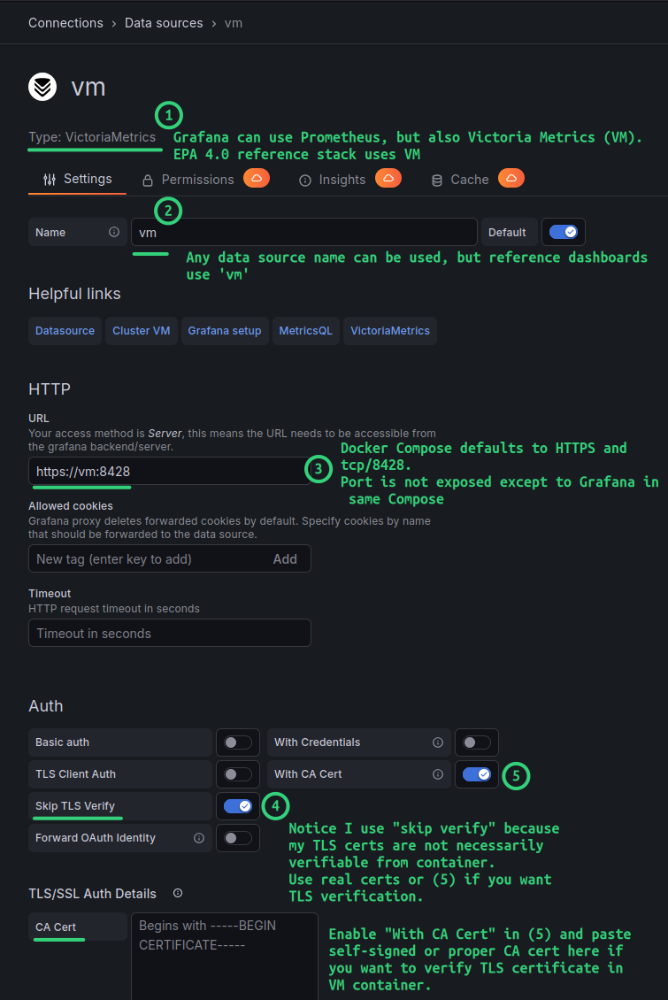

# Configuration

## Prepare data directories

This step is needed if you plan to run Compose stack, which requires data directories for Grafana and Victoria Metrics.

```sh
./scripts/setup-data-dirs.sh
```

`./data/[grafana,grafana-dashboards,vm]` will be created with correct permissions as a result.

I'm not even sure the second Grafana sub-directory (grafana-dashboards) is still required, but it may be if you want to upload own dashboards or something along those lines. They don't take up any space so it doesn't really matter.

## Prepare TLS certificates

This step is required if you plan to run Victoria Metrics or Grafana as these require TLS certificates. If you provide your own, you can skip this step.

```sh
./scripts/gen_ca_tls_certs.py -h
```

You may use `all`, but reject E-Series certificate collection if your E-Series certificates are factory-shipped as you'd need to skip TLS validation on those from Collector in any case.

## Configure and test Collector's Prometheus service port

It is strongly recommended to just leave Collector's Prometheus port at 9080 as it is in `.env` and `collector.py` because there are dependencies (including in Traefik).

If you change Prometheus port to another value *and* want to use Victoria Metrics, set the same port in `./vm/prometheus.yml` before starting Victoria Metrics service. To scrape multiple Collectors from Victoria Metrics, add them to `./vm/prometheus.yml` or see `vm/prometheus-two-array.yml`.

Example test for `collector1` (if two collectors are used, the first one may be `collector1`):

```sh
# single collector setup
sudo docker exec vm wget -qO- http://collector:9080/metrics | head -3
# multi-collector setup depends on the name you gave it; by convention, in multi-array setups we use collector1
sudo docker exec vm wget -qO- http://collector1:9080/metrics | head -3
```

## Configure Traefik

By default, you don't have to. Traefik simply routes external requests to `collector` and `grafana` **via HTTPS only**. Victoria Metrics accesses Collector from *within* the stack and without going through Traefik.

You may disable or remove `traefik` service if you do not wish to allow external access to Collector's metrics. If you deal with untrusted networks, `traefik.http.middlewares.*` can be configured to add rate limiting, and other features (such as authentication) can be added for extra security.

You may replace the self-generated Traefik TLS certificate with own by adding them to `./certs/proxy/` and optionally editing `./traefik_dynamic.yml` if your certificate file names are different. The CA certificate can be left in place so that Traefik can validate Grafana or potentially other TLS service (such as VM, if it's enabled for TLS access) behind it.

Note that Traefik presently does not validate self-signed TLS certificate created for Grafana because Traefik requires SAN information to match host name for which self-signed TLS certificates would have to be generated differently. Since Grafana is running within the same Compose stack and self-signed certificates aren't the right way in any case, HTTPS is used, but validation skipped. You may replace the Grafana certificate with valid TLS certificate on your own if you wish.

## Run Collector

These arguments and switches are available in Compose as well, although it is suggested to not change Prometheus port setting since that requires a change in Victoria Metrics as well - for external access, simply change the Traefik settings instead.

```sh
# 
pip install -r ./epa/requirements.txt
python3 ./epa/collector.py -h
usage: collector.py [-h] [-u USERNAME] [-p PASSWORD] [--api API [API ...]] 
    [--api-port API_PORT] [-t {60,120,300,600}] [-s] [-v] [--showFlashCache] [-f] [-a] [-d]
    [-b] [-ct] [-c] [-m] [-e] [-g] [-pw] [-en] [-i] [--debug] [--debug-force-config] 
    [--include INCLUDE [INCLUDE ...]] [--prometheus-port PROMETHEUS_PORT] 
    [--max-iterations MAX_ITERATIONS] [--capture [DIR]] [--no-verify-ssl]
```

Some of the more impactful arguments:

```sh
options:
  -h, --help            show this help message and exit
  -u USERNAME, --username USERNAME
                        Username to connect to the SANtricity API. Required. Default: 'monitor'. <String>
  -p PASSWORD, --password PASSWORD
                        Password for this user to connect to the SANtricity API. Required. Default: ''. <String>
  --api API [API ...]   The IPv4 address for the SANtricity API endpoint. Required. Example: --api 5.5.5.5 6.6.6.6. Port number is auto-set to:
                       '8443'. May be provided twice (for two controllers). <IPv4 Address>
  --api-port API_PORT   The port for the SANtricity API endpoint. Default: '8443'.
  -t {60,120,300,600}, --intervalTime {60,120,300,600}
                        Interval (seconds) to poll and export data from the SANtricity API. Default: 60. <Integer>
  -i, --showIteration   Outputs the current loop iteration. Optional. <switch>
  --debug               Enable debug logging to show detailed collection and filtering information. Optional. <switch>
  --debug-force-config  Force config data collection every iteration (for testing). Optional. <switch>
  --prometheus-port PROMETHEUS_PORT
                        Port for Prometheus metrics HTTP server. Default: 8080. Only used when --output includes prometheus.
  --max-iterations MAX_ITERATIONS
                        Maximum number of collection iterations to run (0 = unlimited). Useful for testing. Default: 0.
  --capture [DIR]       Capture SANtricity API request/response payloads to disk for replay or debugging. Optionally specify a directory; if omitted,              files are stored under ./captures/<timestamp>.
  --no-verify-ssl       Disable TLS/SSL certificate verification for SANtricity API connections. Use only in lab/dev environments with self-signed
                        certificates.
                        Default: False (verification enabled).
```

The simplest way to run when using the default `monitor` account:

```sh
pip install -r ./epa/requirements.txt
python3 ./epa/collector.py --api 1.2.3.4 --password monitor123 --no-verify-ssl 
```

Add `--debug --max-iterations 20 --capture /tmp/` to get debug logs for a 20 minute period (as some metrics are collected on a slow schedule).

**NOTE:** `--debug` may expose SANtricity credentials in Collector or Docker logs.

## SANtricity 12.1 transport counters

The `nvmeof`, `rdma`, and `nvme_tcp_kernel` measurement groups are collected by default on arrays positively identified as `EF50` or `EF80` with SANtricity 12.1 or later. Other models, unknown model identifiers, and unknown releases are skipped. This initial allowlist deliberately excludes older arrays even when individual endpoints might return useful data. The `EF80` model identifier has been confirmed against a live 12.1 simulator; `EF50` still requires live confirmation. No numeric model aliases are guessed.

To request only these groups:

```sh
python3 ./epa/collector.py --api 1.2.3.4 --password monitor123 --include nvmeof rdma nvme_tcp_kernel
```

The exporter reads `model` from storage-system metadata and checks the `management` release in firmware `codeVersions`, falling back to `bundleDisplay` when needed. It does not compare the separate RAID firmware version against 12.1. Eligibility is cached for 15 minutes and refreshed earlier when the observed model or firmware metadata changes. Failed or unknown release discovery is retried after 60 seconds.

New metrics have snake_case names and explicit Prometheus types:

| Example | Type | Meaning |
| :--- | :--- | :--- |
| `eseries_nvmeof_controllers` | Gauge | Current controller connections per interface |
| `eseries_nvmeof_keep_alive_timeouts_total` | Counter | Raw cumulative keep-alive timeouts |
| `eseries_nvmeof_queue_commands_total` | Counter | Commands by `queue` (`admin`/`io`) and `status` (`good`/`error`) |
| `eseries_rdma_receive_bytes_total` | Counter | Raw cumulative received bytes |
| `eseries_nvme_tcp_kernel_receive_bytes_total` | Counter | Raw cumulative kernel Ethernet received bytes |

All new metrics have `sys_id`, `sys_name`, `controller_id`, and `interface_id` labels. Connection-limit failures additionally use `limit`, and queue metrics use `queue`. The source fields are explicitly mapped in [epa/mappings.py](./epa/mappings.py); internal keys such as `ethernetRxStatistics` are not exported as metric names.

The collector exports absolute `raw` snapshots, not `relative` values or analysed endpoint averages. Use `rate(eseries_rdma_receive_bytes_total[5m])` for bytes per second, for example. A counter decrease is exported as a reset, not accumulated into an exporter-local counter. Existing metrics and dashboards retain their current names and behavior; this does not rename misleading legacy `_total` gauges or change their types.

Successful empty interface lists produce no statistics, not fabricated zero values. Missing, negative, or invalid numeric fields are omitted, while valid zeros are preserved. Fields marked `unknown` in `qualifiers.raw` are also omitted, including numeric zeros that are explicitly qualified as unknown. Empty/no-usable-data results and HTTP 404/405/501 responses back off for 15 minutes; other HTTP failures, timeouts, invalid JSON, and malformed payloads retry after 60 seconds. Backoff is per array and endpoint. Failed/empty endpoint samples and disappeared interfaces are removed from the export rather than held at their previous values. Discovery and endpoint failures are reported in collector logs.

RDMA `txWaitTime` and unicast/multicast breakdowns are intentionally excluded pending reliable definitions. Real hardware or documentation is needed to confirm counter semantics and accuracy.

Live validation on 2026-10-23 used an EF80 NVMe/RoCE simulator with `model: EF80`, management version `12.10.00.9024`, display version `12.10`, and separate RAID firmware `02.10.01.00`. Read-only requests using the supplied `admin` account succeeded with both system ID `1` and the array WWN. Two collector cycles exposed 128 NVMe-oF samples and 96 RDMA samples across eight interfaces, with valid Prometheus counter/gauge types and a healthy metrics HTTP endpoint. RDMA `symbolErrors` was marked unknown on all interfaces and correctly omitted.

The simulator returned successful empty interface lists for TCP kernel statistics despite identifying as EF80. The exporter produced no TCP kernel metrics and backed off after one request; a model match alone therefore does not guarantee populated counters. Firmware discovery ran once, and NVMe-oF/RDMA were fetched once per polling cycle. The exported values did not change between cycles, so counter progression and accuracy were not established. Populated TCP kernel responses remain fixture-tested only. Permissions under the `monitor` account and EF50 live identification remain unverified.

Offline regression tests cover HTTP failures, discovery caching, nested mappings, Prometheus types, counter resets, endpoint isolation, and selective collector cycles with mocked HTTP. With the collector requirements installed, run them from the checkout root:

```sh
PYTHONPATH=epa python3 -m unittest discover -s tests -p 'test_transport_metrics.py'
```

For live validation, first capture storage-system metadata and firmware `codeVersions` to confirm the model/release gate, then run the selected groups with `--capture --max-iterations 2`. Check access using the `monitor` account as well as response shapes and changes between successive `raw` snapshots. The checked HTTP helper is used by the new discovery/statistics paths and the existing live-statistics fetch; other legacy `.json()` callers retain their old behavior pending a separate migration.

## Configure Grafana data source in Victoria Metrics

Any Prometheus scraper (and database) can be used to scrape EPA Collector metrics through Traefik's external port. The EPA reference stack uses Victoria Metrics which accesses Collector by its Docker service name within the Compose stack.

If you run use this reference stack (Collector, Grafana, Victoria Metrics, Traefik), Grafana's data source will be created automatically when you run `docker compose up` after the above two steps and `grafana-init` container.

If you do it manually elsewhere:



If you use **own** Grafana **and** choose to use Victoria Metrics from EPA stack:

- You need to expose the service port for `vm` service in docker-compose.yml to allow Grafana to reach Victoria Metrics from the outside. This may be done by proxying access to https://vm:8428 via Traefik, or by directly exposing Victoria Metrics' service
- Allow external access from Grafana to the Victoria Metrics port in Compose file (in Traefik or VM service definition)
- If you use Traefik to proxy access to VM, disable TLS certificate validation for VM the same way it is disabled for Grafana (see above in the Traefik section). Additionally, you may enable authentication on Traefik or limit access to the Grafana (source) IP

If you use own Grafana and own Prometheus scraper/database, Collector's Prometheus port is already exposed via Traefik. You can add extra options (TLS, authentication, rate limiting) to Traefik configuration if you wish.

## Down-sampling and retention for Victoria Metrics data

It's all done automatically by Victoria Metrics. Data retention is set to 90 days in the Compose YAML.

Refer to the Victoria Metrics documentation for the details on modifying values.

## Customizing Grafana data source

That's in `./grafana/provisioning/datasources/vm.yml`.

You could, for example, configure Victoria Metrics as a Prometheus data source or scrape Collector data by some other Prometheus-compatible database, in which case you'd want a different data source added to Grafana.

If you replace Victoria Metrics with Prometheus, the reference dashboards may need small changes, so perhaps try adding a new data source first (while leaving VM's "EPA" data source in place), and fully replace VM's "EPA" with a new Prometheus "EPA" if the dashboards work okay with your Prometheus data source.

## Calibration and testing

A minimal workload generator may be used to evaluate collection and visualization of metrics in EPA stack.

```sh
sudo docker compose --profile test up fio-test
```
